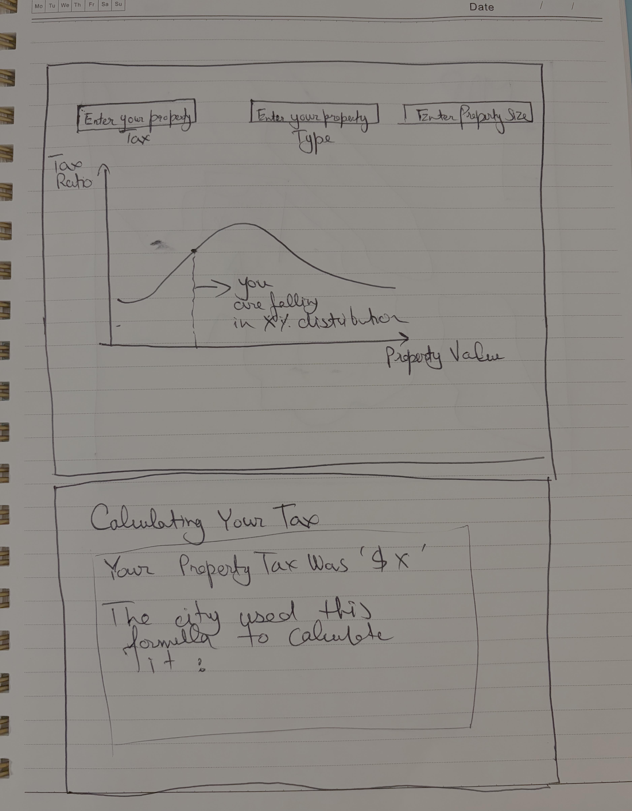
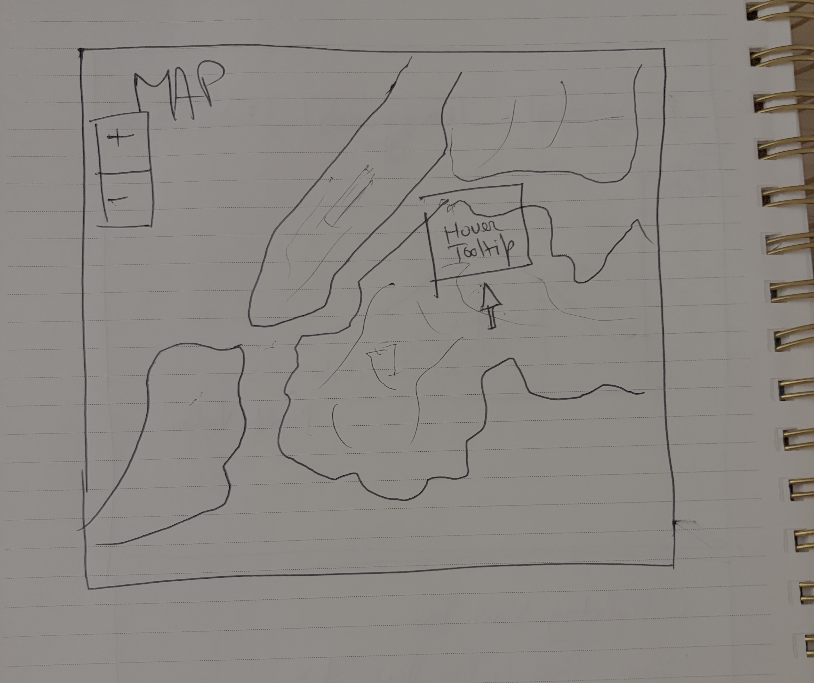

# Faizan Imran

## Description

Getting a sense of one's property tax schedule can help mobilize constituents to demand a more fair property tax schedule. However, the way property tax is caluclated is often very convoluted and it is hard for someone to situate their own personal property tax in a larger city/state wide schedule. For this project I want to build on my static project where I worked with the housing data and ask a different question where users could enter come characteristics about their property and they would be able to see where on the tax schedule they currently fall. I will still be working with NYC's data as that is something that I am familiar with the most.

Since the city uses something called an "Assessed Value" of a property for taxation purposes which is different from the Market Value that most of us are familiar with I want to add a visual component that shows how that value is calculated and other information related to how the tax schedule works. One major problem that introduces regressivity into the tax schedule is the fact that the law mandates a certain cap on how much the assessed value can increase year over year which can cause the assessment to always undervalue how much the market value in increasing year over year.

## Technical Plan: Dynamic Ensemble

I want to allow users to get a sense of where their properyt falls on the distribution and also use other features to plot for the entire city how the tax regime varies - comparing across boroughs and neighborhoods. I also want to add information on how the city calculates property taxes visually to make it easier for users to understand.

I still on using JS for this option and will be using MapLibreGL to show the interactively show the entire map of NYC and use D3 to show where a user's property tax falls on a graph.

I take inspiration from the following two pieces:

- [NYT College-by-College Guide to Which Majors Pay Off](https://www.nytimes.com/interactive/2026/10/07/your-money/college-degree-earnings-guide.html)
  - This piece starts by setting up the distribution of college education pay off and then has a field where one can enter a particular school name and see how that performs.
- [An Extremely Detailed Map of New York City Neighborhood](https://www.nytimes.com/interactive/2023/upshot/extremely-detailed-nyc-neighborhood-map.html)
  - I find this piece super inspiring as well - it's use of coloring different neighborhoods and the hover tool tip is something I want to incorporate for my map as well!

## Mockup

The first half will allow user input to map them onto a distribution and explain exactly how the city calculated their tax:

And scrolling further down they get to visualize the entire city's distribution and what areas have a more progressive/regressive schedule:

## Data Sources

### Data Source 1: Primary Land Use Tax Lot Output (PLUTO)

URL: [PLUTO](https://www.nyc.gov/content/planning/pages/resources/datasets/mappluto-pluto-change)
Size: 858,284 Rows, 108 Columns

This is the most granular data published by the city and each row contains information on a specific tax lot, and contains information like building size, location, its assessed value and the geocoordinates.
